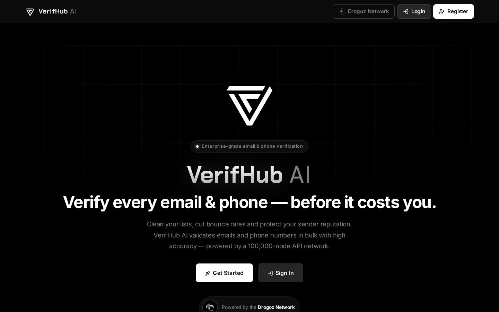
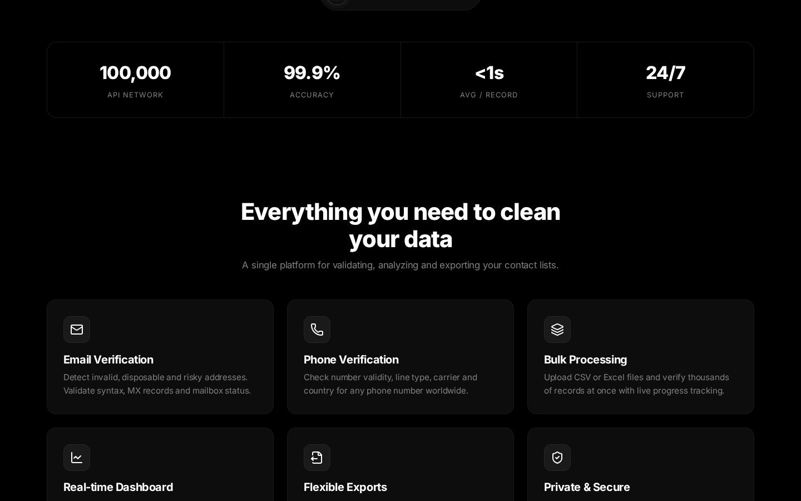
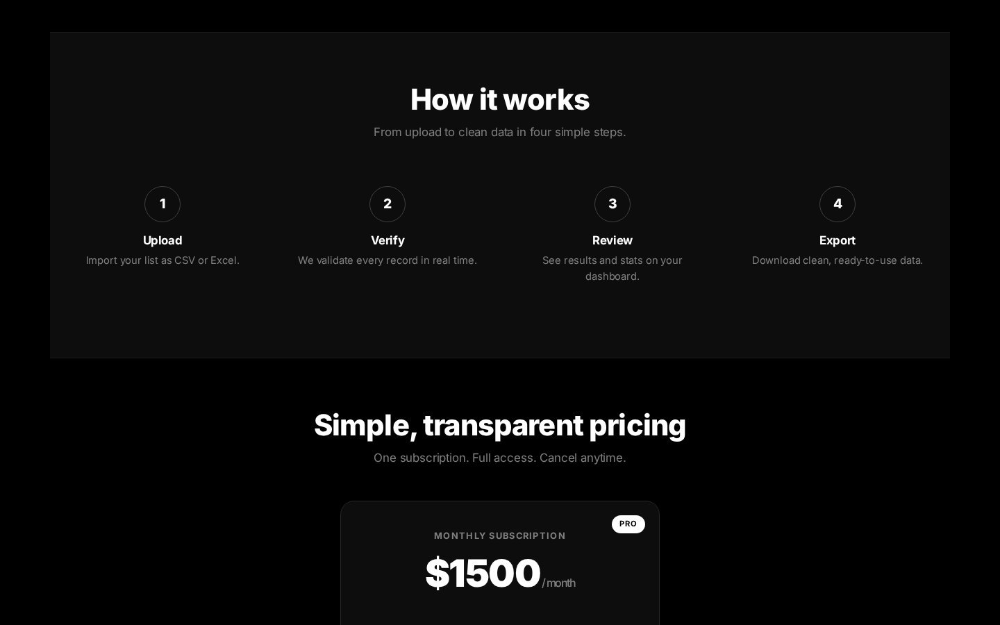
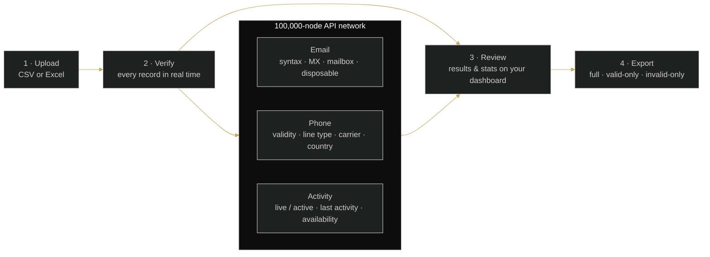

 

# VerifHub AI

### Verify every email & phone — before it costs you.

 

  

 

## 📋 Table of contents

- [Overview](#-overview)
- [Key features](#-key-features)
- [Screenshots](#-screenshots)
- [How it works](#%EF%B8%8F-how-it-works)
- [Use cases](#-use-cases)
- [Pricing](#-pricing)
- [Free live demonstration](#-free-live-demonstration)
- [Links](#-links)

## 🧭 Overview

VerifHub AI validates emails and phone numbers in bulk with high accuracy. Clean your lists, cut bounce rates and protect your sender reputation — powered by millions of IPs and thousands of servers worldwide, with 99.9% accuracy and lightning-fast results (under one second per record on average).

The platform validates contacts, detects activity and improves outreach with real-time intelligence: API handshake verification, phone number and email status checks, live/active contact detection, last-activity tracking and communication-availability checks.

Upload CSV or Excel files and verify thousands of records at once with live progress tracking, monitor results on a real-time dashboard, and export full, valid-only or invalid-only results ready to plug back into your tools. Your data stays yours — processed securely and never shared with third parties.

<table>
<tr>
<td align="center" width="25%"><b>Category</b> Verify</td>
<td align="center" width="25%"><b>Status</b> Live</td>
<td align="center" width="25%"><b>Bundle</b> Traffic (−5%)</td>
<td align="center" width="25%"><b>Pricing</b> Sign in to see pricing</td>
</tr>
</table>

## ✨ Key features

### 📧 Email verification

- **Email Status Check** — detect invalid, disposable and risky addresses.
- **Syntax, MX records and mailbox status** validation.
- **API Handshake Verification** for real-time results.

### 📱 Phone verification

- **Phone Number Status Check** — number validity, line type, carrier and country for any number worldwide.
- **Live / Active Contact Detection** and **Active or Inactive Status Monitoring**.
- **Last Activity Tracking** and **Communication Availability Check**.

### 📦 Bulk processing & exports

- **Bulk Processing** — upload CSV or Excel and verify thousands of records at once with live progress tracking.
- **Real-Time Contact Validation** — fast & accurate verification system.
- **Flexible Exports** — download full, valid-only or invalid-only results.

### 📊 Dashboard & security

- **Real-time Dashboard** — verification statistics, success rates and activity with clear, modern charts.
- **Private & Secure** — your data is processed securely and never shared with third parties.
- **Scale** — 100,000-node API network · 99.9% accuracy · <1 s avg per record · 24/7 support.

## 🖼️ Screenshots

> Product images from [verifhub.ai](https://verifhub.ai/) and the [service page](https://drogoz.network/services/VerifHub/) on drogoz.network.

<table>
<tr>
<td width="50%" align="center"> VerifHub AI — Verify every email & phone</td>
<td width="50%" align="center"> VerifHub AI — Everything you need to clean your data</td>
</tr>
<tr>
<td colspan="2" align="center"> VerifHub AI — How it works</td>
</tr>
</table>

## ⚙️ How it works

**From upload to clean data in four steps**

## 🎯 Use cases

<table>
<tr>
<td width="50%" valign="top"><b>📉 Cut bounce rates</b> Remove invalid, disposable and risky addresses before a campaign goes out.</td>
<td width="50%" valign="top"><b>🛡️ Protect sender reputation</b> Clean lists keep your domains and SMTPs healthy.</td>
</tr>
<tr>
<td width="50%" valign="top"><b>📞 Qualify phone data</b> Line type, carrier, country and live/active detection for every number.</td>
<td width="50%" valign="top"><b>🔄 Data pipelines</b> Bulk CSV/Excel in, clean exports out — ready to plug back into your tools.</td>
</tr>
</table>

## 💳 Pricing

> **Sign in at [drogoz.network](https://drogoz.network/accounts/login/) to see pricing.** Your exact monthly cost, in seconds — no quotes, nothing hidden.

VerifHub AI is part of the **Traffic** bundle (−5%) — *Everything for traffic ops* — and of **All In One** (−10%) — *Every product, best price*. Take several products together and save more: [Packages & bundles](https://drogoz.network/#packages) · [Pricing & calculator](https://drogoz.network/pricing/).

| Bundle | Discount | Included |
|---|---|---|
| **Traffic** | −5% | Lidaro AI, HyperBlast AI, VerifHub AI |
| **All In One** | −10% | Drog AI, MyMask AI, Replika, Lidaro AI, IMPERATORI, ZOI Talks, RiderSwap, HyperBlast AI, VerifHub AI, Vadira, Skriper |

## 🎥 Free live demonstration

**A live demonstration is 100% free on every product.** 
See VerifHub AI in action before you pay — our agent gets in touch and walks you through a live demonstration.

Registration is handled by our team — get in touch and receive personal access.

## 🔗 Links

| Channel | Link |
|---|---|
| 🌐 **Website** | [verifhub.ai](https://verifhub.ai/) |
| 📄 **Details page** | [drogoz.network/services/VerifHub/](https://drogoz.network/services/VerifHub/) |
| ✈️ **Telegram** | [@drogoz](https://t.me/drogoz) |
| 🏛️ **Drogoz Network** | [drogoz.network](https://drogoz.network) · [Services](https://drogoz.network/#services) · [Packages](https://drogoz.network/#packages) · [Pricing](https://drogoz.network/pricing/) · [Presentation](https://drogoz.network/presentation/) |
| ⚖️ **Legal** | [Terms of Service](https://drogoz.network/legal/terms-of-service/) · [Acceptable Use](https://drogoz.network/legal/acceptable-use-policy/) · [Privacy](https://drogoz.network/legal/privacy-policy/) · [Refunds](https://drogoz.network/legal/refund-policy/) · [Disclaimer](https://drogoz.network/legal/disclaimer/) · [Compliance](https://drogoz.network/legal/compliance-policy/) |
| 🐙 **GitHub** | [deepdrogo](https://github.com/deepdrogo/deepdrogo) |

 

   
  
    
  <b>Made by <a href="https://drogoz.network">Drogoz Network</a></b> 
  One network — all your services · Premium SaaS Network
    
  
  
  
  
    
  <b>More from the network:</b> <a href="https://github.com/deepdrogo/drog-ai">Drog AI</a> · <a href="https://github.com/deepdrogo/mymask-ai">MyMask AI</a> · <a href="https://github.com/deepdrogo/replika">Replika</a> · <a href="https://github.com/deepdrogo/lidaro-ai">Lidaro AI</a> · <a href="https://github.com/deepdrogo/imperatori">IMPERATORI</a> · <a href="https://github.com/deepdrogo/zoi-talks">ZOI Talks</a> · <a href="https://github.com/deepdrogo/riderswap-io">RiderSwap</a> · <a href="https://github.com/deepdrogo/hyperblast-ai">HyperBlast AI</a> · <a href="https://github.com/deepdrogo/vadira-net">Vadira</a> · <a href="https://github.com/deepdrogo/skriper-io">Skriper</a> · <a href="https://github.com/deepdrogo/mytasker">MyTasker</a> · <a href="https://github.com/deepdrogo/mamont">Mamont</a>
    
  © 2026 Drogoz Network. All rights reserved. Provided strictly for lawful use — see the <a href="https://drogoz.network/legal/">Legal Center</a>. Each user is solely responsible for how they use the software.

