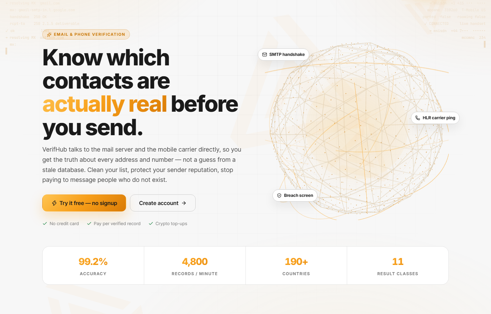
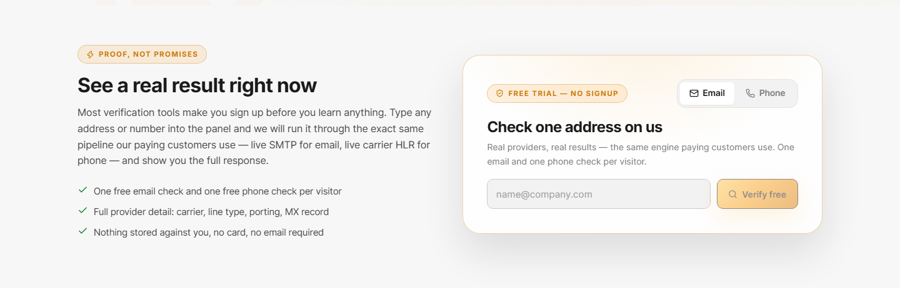
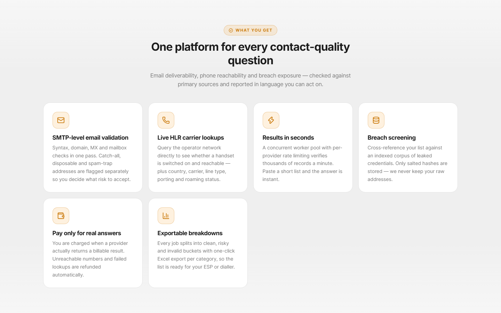
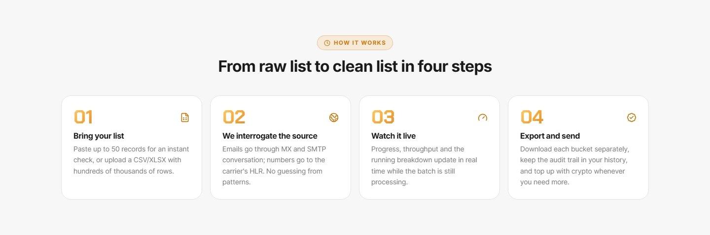
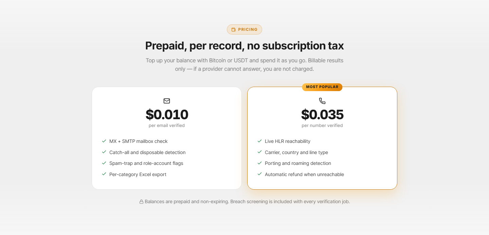
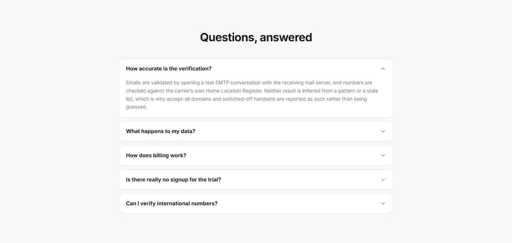
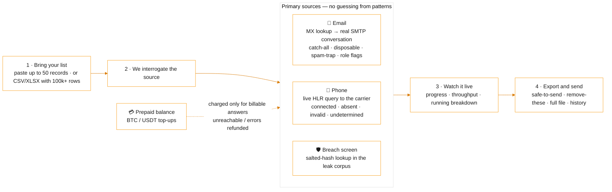

 

# VerifHub AI

### Know which contacts are actually real — before you send.

 

  

 

## 📋 Table of contents

- [Overview](#-overview)
- [Key features](#-key-features)
- [Screenshots](#-screenshots)
- [How it works](#%EF%B8%8F-how-it-works)
- [Use cases](#-use-cases)
- [Pricing](#-pricing)
- [Free live demonstration](#-free-live-demonstration)
- [Links](#-links)

## 🧭 Overview

**VerifHub AI talks to the mail server and the mobile carrier directly**, so you get the truth about every address and number — not a guess from a stale database. Emails are validated by opening a real SMTP conversation with the receiving mail server; phone numbers are checked against the carrier's own Home Location Register (HLR). Neither result is inferred from a pattern or a list, which is why accept-all domains and switched-off handsets are reported as exactly that instead of being guessed.

One platform answers every contact-quality question — **email deliverability, phone reachability and breach exposure** — checked against primary sources and reported in language you can act on. Every job is split into *clean*, *risky* and *invalid* buckets with one-click Excel export per category, so the list is ready for your ESP or dialler the moment it finishes.

Bring a list of any size: paste up to 50 records for an instant check, or upload a CSV/XLSX with hundreds of thousands of rows and watch progress, throughput and the running breakdown update live. Billing is **prepaid and per record** — top up with Bitcoin or USDT, pay only when a provider returns a billable answer, and get automatic refunds for unreachable numbers and failed lookups. Balances never expire, and breach screening is included with every verification job.

**Proof, not promises:** most verification tools make you sign up before you learn anything. VerifHub gives every visitor one free email check and one free phone check — run through the exact same pipeline paying customers use — and shows the full provider response. No card, no email, nothing stored against you.

<table>
<tr>
<td align="center" width="25%"><b>Category</b> Verify</td>
<td align="center" width="25%"><b>Status</b> Live</td>
<td align="center" width="25%"><b>Bundle</b> Traffic (−5%)</td>
<td align="center" width="25%"><b>Pricing</b> Prepaid · per record</td>
</tr>
</table>

## ✨ Key features

### 📧 SMTP-level email validation

- **Real SMTP conversation** with the receiving mail server — syntax, domain, MX and mailbox checks in one pass.
- **Catch-all / accept-all detection** — domains that accept every address are flagged separately so you decide what risk to accept.
- **Disposable, spam-trap and role-account flags** — throwaway providers and known trap addresses never reach your campaign.
- **11 result classes** — Valid · Accept-all · Disposable · Spam trap · Mailbox disabled · Dead server · No MX record · Invalid syntax · SMTP blocked · Anti-spam · Unknown — each with a plain-English explanation (see [Result classes](#%EF%B8%8F-result-classes)).

### 📱 Live HLR carrier lookups

- **Live reachability** — the operator network is queried directly to see whether a handset is switched on and registered right now.
- **Full provider detail** — country with ISO code, current operator (and the original one if ported), line type, MCC + MNC network code and the number in clean E.164 format.
- **Porting and roaming detection** — know when the owner moved to another operator or is currently abroad on a foreign network.
- **Worldwide coverage** — HLR lookups work in 190+ countries; undetermined lookups (no operator answer) are never charged and are free to retry.

### 🛡️ Breach screening

- **Cross-reference your list against an indexed corpus of leaked credentials** — see which addresses appear in known data leaks before you rely on them.
- **Privacy by design** — inputs are hashed before they touch the index and only salted hashes are stored; raw addresses are never kept.
- **Included with every verification job**, plus a standalone Breach checker and Breach report in the dashboard.

### ⚡ Speed, scale & workflow

- **Quick check** — paste up to 50 emails or phone numbers and get the answer instantly.
- **Bulk upload** — CSV or XLSX with hundreds of thousands of rows; all your other columns come back untouched.
- **Results in seconds** — a concurrent worker pool with per-provider rate limiting verifies thousands of records a minute (≈4,800 records/min).
- **Watch it live** — progress, throughput and the running breakdown update in real time while the batch is still processing.
- **Exportable breakdowns** — download *safe to send*, *remove these* and *all rows with status* separately, or the full verified file; every job stays in your history as an audit trail.

### 💳 Billing & account

- **Prepaid, per record, no subscription tax** — hold a balance and spend it as you go; balances are non-expiring.
- **Crypto top-ups** — Bitcoin or USDT: choose the asset and network, send the transfer, submit the transaction hash, balance credited after on-chain confirmation.
- **Pay only for real answers** — a record is charged only when the provider returns a billable result; unreachable numbers and provider errors are refunded automatically.
- **Free trial without an account** — one live email check and one live phone check per visitor, straight from the landing page.
- **Dashboard** — verification workspace with quick check, bulk uploads, job history, live progress, result breakdowns, payment history, light / dark mode and a dedicated manager with 24/7 support.

## 📊 By the numbers

<table><tr><td align="center" width="25%"><h3>99.2%</h3>ACCURACY</td><td align="center" width="25%"><h3>4,800</h3>RECORDS / MINUTE</td><td align="center" width="25%"><h3>190+</h3>COUNTRIES</td><td align="center" width="25%"><h3>11</h3>RESULT CLASSES</td></tr></table>

No credit card · Pay per verified record · Crypto top-ups · SMTP handshake · HLR carrier ping · Breach screen

## 🏷️ Result classes

Every record comes back with a class and a plain-English hint, so non-technical users can act on it.

**Email**

| Class | Bucket | Meaning |
|---|---|---|
| **Valid** | ✅ Safe | The mailbox exists and accepts mail. |
| **Accept-all** | ⚠️ Risky | The domain accepts every address, so the mailbox cannot be confirmed. |
| **Disposable** | ⚠️ Risky | A throwaway address provider. |
| **Spam trap** | ⚠️ Risky | Known trap address — never send to it. |
| **Mailbox disabled** | ❌ Invalid | The account exists but is switched off. |
| **Dead server** | ❌ Invalid | The mail server did not respond. |
| **No MX record** | ❌ Invalid | The domain cannot receive mail. |
| **Invalid syntax** | ❌ Invalid | Not a well-formed address. |
| **SMTP blocked** | ❔ Unknown | The server refused to complete the check. |
| **Anti-spam** | ❔ Unknown | A filter intercepted the probe. |
| **Unknown** | ❔ Unknown | No definitive answer from the server. |

**Phone (HLR)**

| Class | Bucket | Meaning |
|---|---|---|
| **Connected** | ✅ Live | Live handset, registered on the network right now. |
| **Absent** | ⚠️ Risky | Real number, but switched off or out of coverage. |
| **Invalid number** | ❌ Invalid | Not assigned to any subscriber. |
| **Undetermined** | ❔ Unknown | No operator answered — **not charged**, free to retry. |

**Every phone result also carries:** current operator (and the original one if ported) · country with ISO code · ported flag · roaming flag with the foreign network named · MCC + MNC network code · the number in clean international (E.164) format.

## 🖼️ Screenshots

> Product images from [verifhub.ai](https://verifhub.ai/) and the [service page](https://drogoz.network/services/VerifHub/) on drogoz.network.

<table>
<tr>
<td width="50%" align="center"> verifhub.ai — Know which contacts are actually real before you send · 99.2% accuracy · 4,800 records/min · 190+ countries</td>
<td width="50%" align="center"> Free trial — one live email check and one live phone check per visitor, no signup, full provider detail</td>
</tr>
<tr>
<td width="50%" align="center"> One platform for every contact-quality question — SMTP validation, HLR lookups, breach screening, exports</td>
<td width="50%" align="center"> From raw list to clean list in four steps</td>
</tr>
<tr>
<td width="50%" align="center"> Prepaid, per record — Bitcoin / USDT top-ups, billable results only</td>
<td width="50%" align="center"> Questions, answered — accuracy, data handling, billing, trial, international numbers</td>
</tr>
</table>

## ⚙️ How it works

**From raw list to clean list in four steps**

## 🎯 Use cases

<table>
<tr>
<td width="50%" valign="top"><b>📉 Cut bounce rates</b> Remove invalid, disposable, spam-trap and dead-server addresses before a campaign goes out — send only to the <i>safe to send</i> bucket.</td>
<td width="50%" valign="top"><b>🛡️ Protect sender reputation</b> Accept-all domains are flagged separately, so you choose the risk you accept and keep your domains and SMTPs healthy.</td>
</tr>
<tr>
<td width="50%" valign="top"><b>📞 Reach people who pick up</b> Live HLR tells your dialler or SMS platform which handsets are switched on right now, which are ported and which are roaming.</td>
<td width="50%" valign="top"><b>🔐 Screen for breach exposure</b> See which contacts appear in leaked credential dumps before onboarding, re-engagement or KYC follow-ups.</td>
</tr>
<tr>
<td width="50%" valign="top"><b>🌍 International lists</b> Country, ISO code, operator, MCC/MNC and E.164 formatting for every number, in 190+ countries.</td>
<td width="50%" valign="top"><b>🔄 Data pipelines</b> CSV/XLSX in, per-category Excel out — all your other columns preserved, ready to plug back into your ESP, CRM or dialler.</td>
</tr>
</table>

## 💳 Pricing

> **Prepaid, per record, no subscription tax.** Top up your balance with **Bitcoin or USDT** and spend it as you go. A record is charged only when the provider returns a billable answer — unreachable numbers and provider errors are refunded to your balance automatically. Balances are prepaid and **non-expiring**, and breach screening is included with every verification job.

| Check | Price | What is included |
|---|---|---|
| 📧 **Email** | **$0.010** per email verified | MX + SMTP mailbox check · catch-all and disposable detection · spam-trap and role-account flags · per-category Excel export |
| 📱 **Phone** | **$0.035** per number verified | Live HLR reachability · carrier, country and line type · porting and roaming detection · automatic refund when unreachable |

Per-record prices as published on <a href="https://verifhub.ai/#pricing">verifhub.ai</a> (September 2026) — the balance page inside the product always shows the current rate. Create an account in under a minute: no card, no sales call — top up when you are ready to run your first batch.

VerifHub AI is part of the **Traffic** bundle (−5%) — *Everything for traffic ops* — and of **All In One** (−10%) — *Every product, best price*. Take several products together and save more: [Packages & bundles](https://drogoz.network/#packages) · [Pricing & calculator](https://drogoz.network/pricing/).

| Bundle | Discount | Included |
|---|---|---|
| **Traffic** | −5% | Lidaro AI, HyperBlast AI, VerifHub AI |
| **All In One** | −10% | Drog AI, MyMask AI, Replika, Lidaro AI, IMPERATORI, ZOI Talks, RiderSwap, HyperBlast AI, VerifHub AI, Vadira, Skriper |

## 🎥 Free live demonstration

**A live demonstration is 100% free on every product.** 
See VerifHub AI in action before you pay — our agent gets in touch and walks you through a live demonstration. Or try it yourself first: One free email check and one free phone check per visitor — no signup, no card.

Registration is handled by our team — get in touch and receive personal access.

## 🔗 Links

| Channel | Link |
|---|---|
| 🌐 **Website** | [verifhub.ai](https://verifhub.ai/) |
| 📄 **Details page** | [drogoz.network/services/VerifHub/](https://drogoz.network/services/VerifHub/) |
| ✈️ **Telegram** | [@drogoz](https://t.me/drogoz) |
| 🏛️ **Drogoz Network** | [drogoz.network](https://drogoz.network) · [Services](https://drogoz.network/#services) · [Packages](https://drogoz.network/#packages) · [Pricing](https://drogoz.network/pricing/) · [Presentation](https://drogoz.network/presentation/) |
| ⚖️ **Legal** | [Terms of Service](https://drogoz.network/legal/terms-of-service/) · [Acceptable Use](https://drogoz.network/legal/acceptable-use-policy/) · [Privacy](https://drogoz.network/legal/privacy-policy/) · [Refunds](https://drogoz.network/legal/refund-policy/) · [Disclaimer](https://drogoz.network/legal/disclaimer/) · [Compliance](https://drogoz.network/legal/compliance-policy/) |
| 🐙 **GitHub** | [deepdrogo](https://github.com/deepdrogo/deepdrogo) |

 

   
  
    
  <b>Made by <a href="https://drogoz.network">Drogoz Network</a></b> 
  One network — all your services · Premium SaaS Network
    
  
  
  
  
    
  <b>More from the network:</b> <a href="https://github.com/deepdrogo/drog-ai">Drog AI</a> · <a href="https://github.com/deepdrogo/mymask-ai">MyMask AI</a> · <a href="https://github.com/deepdrogo/replika">Replika</a> · <a href="https://github.com/deepdrogo/lidaro-ai">Lidaro AI</a> · <a href="https://github.com/deepdrogo/imperatori">IMPERATORI</a> · <a href="https://github.com/deepdrogo/zoi-talks">ZOI Talks</a> · <a href="https://github.com/deepdrogo/riderswap-io">RiderSwap</a> · <a href="https://github.com/deepdrogo/hyperblast-ai">HyperBlast AI</a> · <a href="https://github.com/deepdrogo/vadira-net">Vadira</a> · <a href="https://github.com/deepdrogo/skriper-io">Skriper</a> · <a href="https://github.com/deepdrogo/drogopay-com">DrogoPay</a> · <a href="https://github.com/deepdrogo/hashgram">Hashgram One</a> · <a href="https://github.com/deepdrogo/mytasker">MyTasker</a> · <a href="https://github.com/deepdrogo/mamont-tech">Mamont</a> · <a href="https://github.com/deepdrogo/drogscan">DrogScan</a>
    
  © 2026 Drogoz Network. All rights reserved. Provided strictly for lawful use — see the <a href="https://drogoz.network/legal/">Legal Center</a>. Each user is solely responsible for how they use the software.

